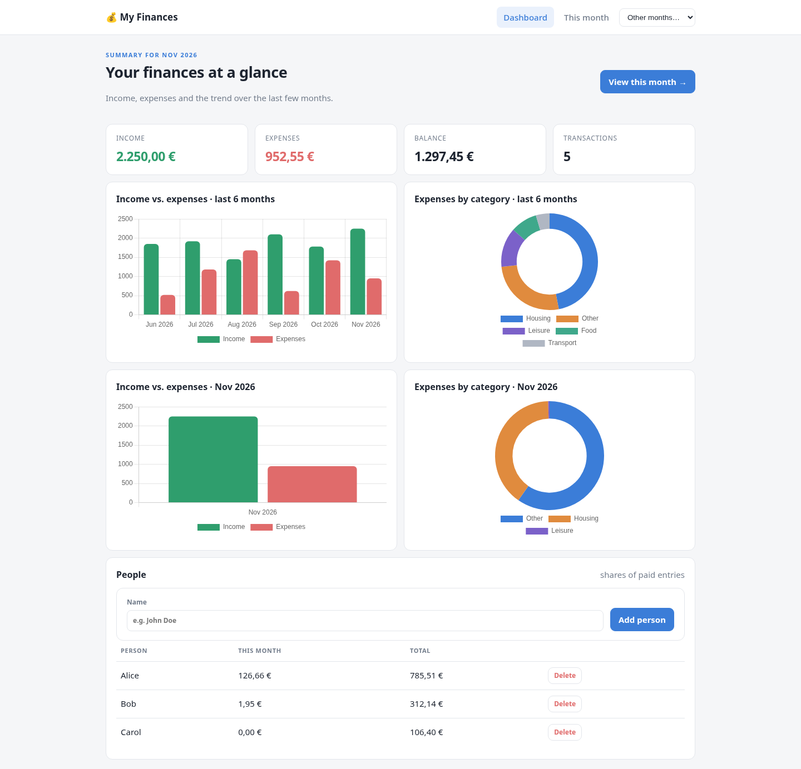
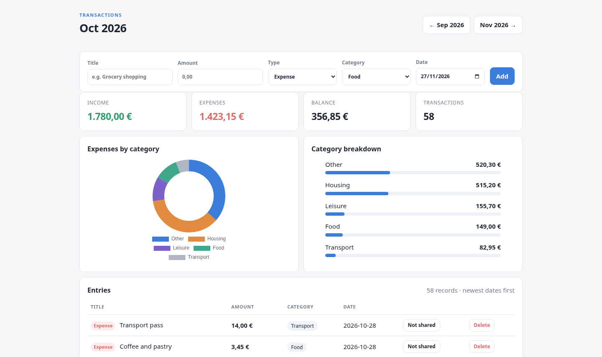

# Finances

Local app to record expenses and income and view them by month. C++20 with Crow, SQLite (via SQLiteCpp) and HTML + HTMX/Chart.js.

<p align="center"></p>
<p align="center"></p>

## Getting started

You need CMake (≥ 3.23), Conan 2 and a compiler with C++20 (`std::format` and the `std::chrono` calendar: GCC ≥ 13, Clang ≥ 17 with libstdc++ 13, MSVC 2022). Crow, Asio and SQLiteCpp (with SQLite3) are managed with Conan; HTMX and Chart.js are served as local static files.

```sh
conan profile detect # first time only
conan install . --output-folder=build --build=missing
conan install . --output-folder=build --build=missing -s build_type=Debug # only if you use the debug preset
cmake --preset release
cmake --build --preset release
./build/release/finances
```

Open <http://127.0.0.1:8080>. The executable reads `templates/` and `static/` and creates `finances.db` in the current working directory, so run it from here (it refuses to start if the templates are missing) or set `FINANCES_HOME=/path/to/project`. `FINANCES_PORT` changes the port (default 8080).

The server only answers `Host: 127.0.0.1:<port>` / `localhost:<port>`, and non-GET requests must carry `HX-Request: true` (htmx adds it), which blocks cross-site forms and DNS rebinding. CMake generates `build/release/compile_commands.json` (or `build/debug/` with the `debug` preset).

## Showcase

`finances.db` in the project root is a generated sample database: 163 English entries (Jun–Nov 2026), 30 shared parts and three people (Alice, Bob, Carol). It is git-ignored, so it never lands in a commit. Run the app from the project root as usual, optionally on another port:

```sh
FINANCES_PORT=18080 ./build/release/finances
```

Open <http://127.0.0.1:18080>. The months are deliberately uneven — August ends in the red — so the charts show clear differences.

Dashboard (full page):


October 2026 listing (full page):


| Month | Income | Expenses | Balance |
|---|---:|---:|---:|
| 2026-06 | 1.850,00 € | 520,30 € | 1.329,70 € |
| 2026-07 | 1.920,00 € | 1.184,30 € | 735,70 € |
| 2026-08 | 1.450,00 € | 1.682,45 € | -232,45 € |
| 2026-09 | 2.100,00 € | 622,95 € | 1.477,05 € |
| 2026-10 | 1.780,00 € | 1.423,15 € | 356,85 € |
| 2026-11 | 2.250,00 € | 952,55 € | 1.297,45 € |

| Person | This month | Total |
|---|---:|---:|
| Alice | 126,66 € | 785,51 € |
| Bob | 1,95 € | 312,14 € |
| Carol | 0,00 € | 106,40 € |

## Usage

- **Dashboard**: current month balance, trend over the last 6 months and expenses by category.
- **This month / Other months**: list ordered by date (newest first), with its statistics and a form to add entries. The form updates the list and statistics without reloading the page (HTMX).
- Each entry has a title, amount, type (expense/income), category (Food, Transport, Housing, Leisure, Other) and date. The amount accepts a comma or a dot as the decimal separator, with at most two decimal places, and thousands separators (`12,50`, `1.234,56`, `1,234.56`, `1.234.567`). A lone `1.234` is rejected as ambiguous instead of being read as €1.23. Titles and names are limited in characters, not bytes.
